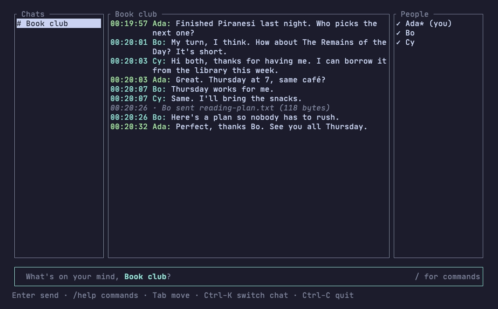
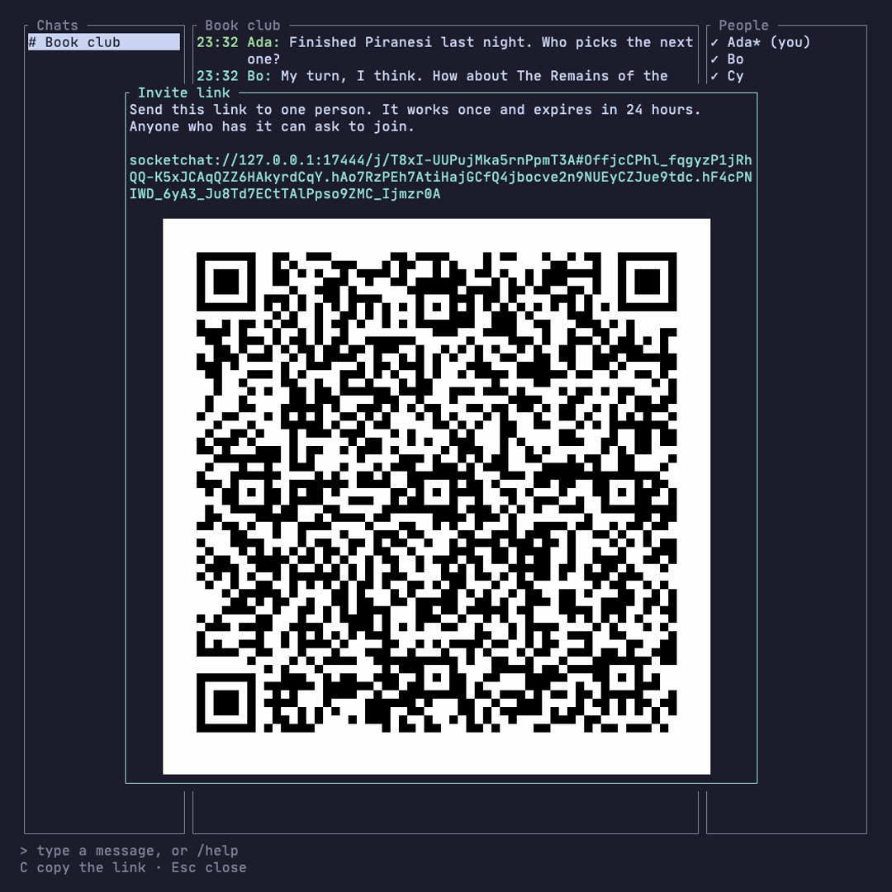
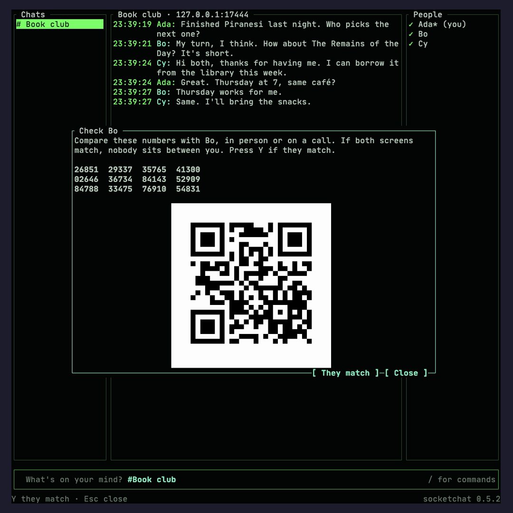
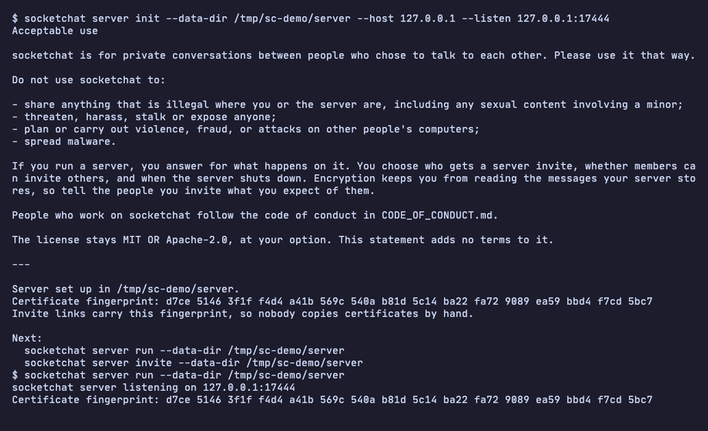
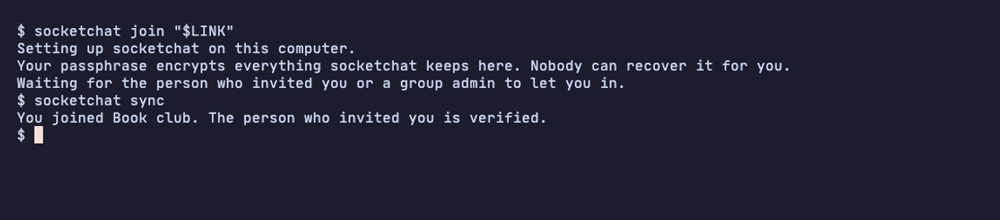

# socketchat

socketchat is a full-featured encrypted chat with a server you run yourself. The server runs anywhere, from a cloud server or a home computer down to a small device such as a Raspberry Pi, and you invite people with a link. The server passes messages along but cannot read them: messages, files and changes to who is in a room are end-to-end encrypted, which means only the people in a chat can read them.

What you get:

- Rooms, which are group chats, and direct messages.
- Invite links, shown as text and as a QR code.
- Verification with safety numbers, so you can check that nobody sits between you and a friend.
- Files, photos and videos. Photos lose their location and device data before they leave.
- Admins, who can remove people, make other admins and rename a room. A room closes for everyone once its admins agree.
- Room history that leaves your computer once you are out of the room and have read it.
- Post-quantum protection, meaning protection against a future quantum computer, on by default.
- A server that cannot read your messages.

socketchat v4 is a terminal app written in Rust. Its encryption comes from a published standard and an audited library, with no home-made cryptography.

## Why it exists

No other project we know of pairs a light self-hosted server with standard group encryption and post-quantum protection. The group encryption standard is MLS (Messaging Layer Security), published by the Internet Engineering Task Force (IETF) as RFC 9420 in 2023. In MLS a sender encrypts a message once and the server copies it to every member.

How nearby projects compare:

- **Matrix** can be self-hosted, but its server is heavy.
- **Wire** uses MLS, but self-hosting it needs its Enterprise edition.
- **SimpleX** is light, but in a group the sender's own device delivers every message to every member.
- **Signal** hides group membership from its servers with anonymous credentials, which it built for its own service. That code is licensed under the AGPL and sits outside the MLS standard.

socketchat's server is one program with its data in one folder. A release build on a Mac used 10 MB of memory while idle.

## Quick start

Install socketchat with one command. On macOS or Linux, run this in a terminal:

```
curl --proto '=https' --tlsv1.2 -LsSf https://github.com/sachio222/socketchat_v4/releases/latest/download/socketchat-installer.sh | sh
```

On Windows, run this in PowerShell:

```
powershell -ExecutionPolicy Bypass -c "irm https://github.com/sachio222/socketchat_v4/releases/latest/download/socketchat-installer.ps1 | iex"
```

The installer downloads a prebuilt `socketchat` program for your computer, puts it in `~/.local/bin`, and adds that folder to your PATH if it is missing. Open a new terminal afterwards so the PATH change takes effect. You do not need Rust or any other library, because the encryption code is built into the program.

Prebuilt programs cover:

- macOS on Apple silicon and on Intel.
- Linux on Intel or AMD (x86_64), which covers most cloud servers and desktop computers, and on 64-bit ARM (aarch64), which includes a Raspberry Pi 4 or Zero 2 W running 64-bit Raspberry Pi OS. They need glibc 2.35 or newer, which Ubuntu 22.04, Debian 12 and Raspberry Pi OS 12 (Bookworm) have.
- 64-bit Windows on Intel or AMD.

**Or build from source**, for a system the prebuilt programs do not cover. You need the Rust toolchain from [rustup.rs](https://rustup.rs). On Linux, also install the OpenSSL headers, which the encrypted local database needs:

```
sudo apt install build-essential pkg-config libssl-dev
```

Then install socketchat:

```
cargo install --locked --git https://github.com/sachio222/socketchat_v4 socketchat
```

On Windows, add `--features vendored-openssl` to that command. It builds OpenSSL from source, which needs the Visual Studio C++ build tools and [Strawberry Perl](https://strawberryperl.com).

The first build compiles socketchat and all its libraries. It takes several minutes on a fast machine (about five and a half minutes in a clean arm64 Linux container on an Apple Silicon Mac) and much longer on a Raspberry Pi.

Once socketchat is installed, the steps below take a few minutes.

On the machine that will be the server, set it up and start it. Use the name or IP address other people will dial for `--host`:

```
socketchat server init --host chat.example.com
socketchat server run
```

`init` prints the acceptable-use statement, writes a config file, and makes a TLS certificate, which lets apps check that they reached your server and encrypts the connection. Invite links carry the certificate's fingerprint, so nobody copies files between machines. People reach the server on port 7444, so open that port on your firewall or router.

In a second terminal on the server, make a one-time invite link for yourself:

```
socketchat server invite
```

On your own computer, use the link. The first time, socketchat asks for a display name and a passphrase that encrypts everything it keeps on this computer:

```
socketchat join "socketchat://chat.example.com:7444/j/..."
```

The chat screen opens. Start a room and invite a friend:

```
/new Friends
/invite
```

`/invite` shows a link and a QR code. Your friend installs socketchat and runs `socketchat join <link>`. While your app is open, it lets them in. Your friend's app checks that the link came from you and marks you verified. From then on, either of you opens the chat screen with:

```
socketchat
```

Type `/help` in the chat screen to see every command. `/switch` opens another room, and Tab completes its name. `/details` shows a room's admins, size and age, `/mute` hides its new-message count, and `/invites` lists the invite links you made that still work. Admins rename a room with `/title` and ask to close it with `/close`. [docs/running-a-server.md](docs/running-a-server.md) covers a server that runs all the time.

## What leaving and closing delete

When you leave a room, socketchat deletes the room's keys from your computer at once. When you are removed or the room closes, it deletes them as soon as your app learns of it, which for an app that was not running is its next sync with the server. The room's messages go once you have read them: after your own leave at once, and after a removal or a close when you open another room or quit. Messages you have not read stay until you read them. Once 30 days have passed since the room ended for you, socketchat deletes them anyway the next time it opens, you open another room or it quits. `/clear` deletes a room's messages from your computer while you stay in it. Deletion happens in each person's own app, so other members keep their copies, and anyone can photograph a screen. A 0.5.0 server deletes everything it holds for a room once the last member's app leaves while alone in it, as an admin's app does at the end of a close. [SECURITY.md](SECURITY.md) has the details.

## Screenshots

A room with three people:



The invite box with its QR code:



Two people comparing safety numbers, a 60-digit number that matches on both screens when nobody sits between them:



Setting up and running a server:



Joining from the command line:



## What the server sees

The server stores and forwards encrypted data. It never sees message text, file contents, display names, room names, or any key that can decrypt them. It does see the size and timing of encrypted messages and files, the IP addresses of connected apps, and for each room a list of random keys and the signed changes to that list. A person gets a fresh random key in every room, so no key or ID in the server's records ties one person's rooms together. Someone watching the server live can still link a person's rooms by IP address and connection.

[SECURITY.md](SECURITY.md) has the full list, the cryptography, and what socketchat does not protect.

## Documents

- [SECURITY.md](SECURITY.md): what the server sees, the cryptography, limits, and how to report a vulnerability.
- [ACCEPTABLE_USE.md](ACCEPTABLE_USE.md): what socketchat is for.
- [docs/files-photos-videos.md](docs/files-photos-videos.md): how sending files works and its limits, for everyone.
- [docs/running-a-server.md](docs/running-a-server.md): a server that runs all the time, on a cloud server, a home computer or a Raspberry Pi.
- [CHANGELOG.md](CHANGELOG.md): what changed in each release.
- [ROADMAP.md](ROADMAP.md): planned work, and where help is welcome.
- [CONTRIBUTING.md](CONTRIBUTING.md): building, testing and reviews.
- [CODE_OF_CONDUCT.md](CODE_OF_CONDUCT.md): Contributor Covenant 2.1.
- [docs/architecture.md](docs/architecture.md) and [docs/protocol.md](docs/protocol.md): how the code fits together, for contributors.
- [docs/design.md](docs/design.md): the design socketchat v4.0 was built from.

## License

Licensed under either of [MIT](LICENSE-MIT) or [Apache-2.0](LICENSE-APACHE), at your option.
