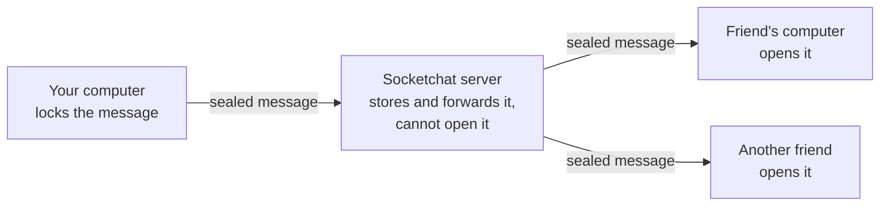

Socketchat is a group chat that runs in your terminal on macOS, Linux and Windows. You run a small server, invite friends with a link, and talk in rooms that only the people inside can read. No phone number, email or ID is needed. These docs cover Socketchat 0.6.1.

## How it works

Every message is locked on your computer before it leaves, and only the people in the room hold the keys to open it. This is called end-to-end encryption. The server sits in the middle and passes sealed messages along. It stores them until each friend's app collects them, and it never holds a key that can open them.

One program, `socketchat`, does both jobs. On your own computer it opens the chat screen. On the machine you pick as the server, `socketchat server` runs the server, with all its data in one folder. Apps never connect to each other directly, so every group needs one server. [How Socketchat works](/how-it-works) explains who runs it and who only needs the app.

## Who it is for

- **Friends and small groups** who want a private room without handing their messages to a company.
- **People who like the terminal**, including over SSH. The chat screen fits an 80 by 24 window.
- **Scripts and AI agents**, which join rooms and send messages through the same command. See [Agents](/use/agents).

## What you get

- Rooms (group chats) and direct messages.
- Invite links that work once, shown as text and as a QR code that opens a join page on a phone, and invites by name for someone you already share a room with.
- Safety numbers, so you and a friend can check that nobody sits between you, and a warning when someone new shows under the name of a person you verified.
- Files, photos and videos, sent with `/send` or dropped on the window. Photos lose their location and device data before they leave.
- Admins who can remove people, rename a room, set its topic, choose who can invite and turn on slow mode. A room closes for everyone once its admins agree.
- Protection against a future quantum computer, on by default.

## Where to start

<Columns cols={2}>
  <Card title="Install" icon="download" href="/install">
    One command on macOS, Linux or Windows.
  </Card>
  <Card title="Quick start" icon="rocket" href="/quickstart">
    From nothing to a room with a friend.
  </Card>
  <Card title="Host a server" icon="server" href="/hosting/overview">
    Pick how your friends will reach you.
  </Card>
  <Card title="What the server sees" icon="shield" href="/security/what-the-server-sees">
    What stays private, in plain words.
  </Card>
</Columns>
